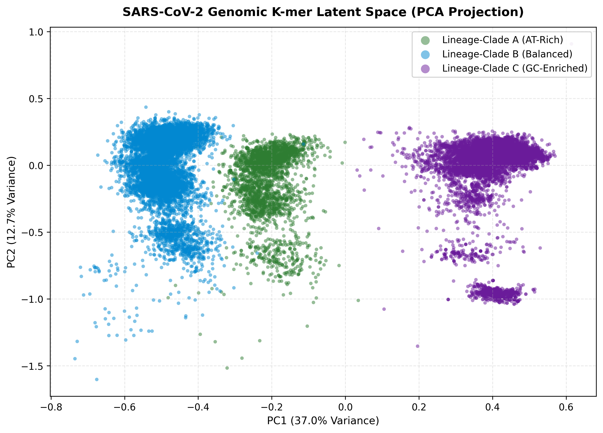
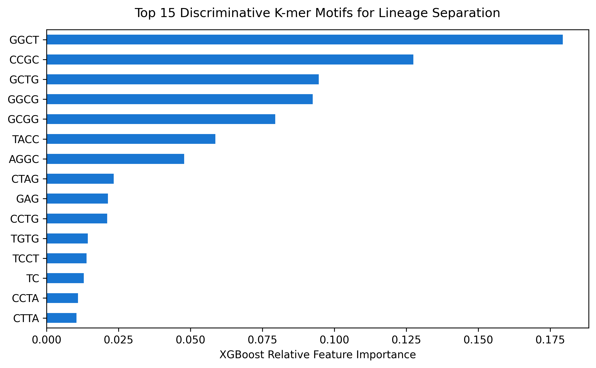
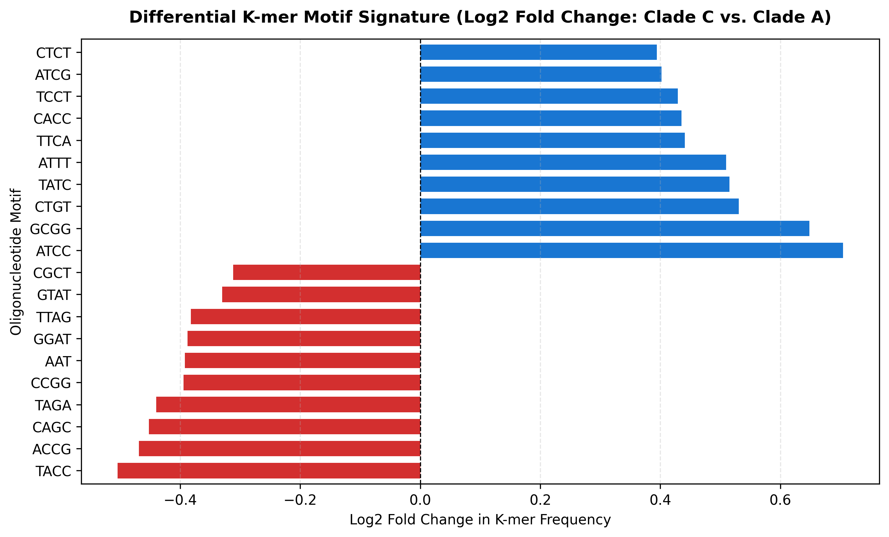

# SARS-CoV-2 Genomic Variant Clustering with k-mer Frequencies

Unsupervised clustering of SARS-CoV-2 genomes using k-mer (1- to 4-mer) frequency features, followed by supervised feature importance to identify the k-mers that best separate the clusters.

## Dataset

[`tavoglc/covid19-sequence-kmer-frequencies`](https://www.kaggle.com/datasets/tavoglc/covid19-sequence-kmer-frequencies) on Kaggle (`KmerData.csv`): 341 k-mer frequency columns plus an `id` accession column, ~30k isolates used here.

The data is **not** included in this repo (it is large). Download it and place it in `data/`:

```bash
kaggle datasets download -d tavoglc/covid19-sequence-kmer-frequencies -p data/ --unzip
```

> The notebook's `csv_path` points to a Kaggle input path. Change it to `data/KmerData.csv` to run locally.

## Methods

1. **PCA** to 2 components (~37% + 12.7% of variance explained).
2. **MiniBatchKMeans** (k=3) to define unsupervised "clades" (A, B, C).
3. **Validation** with silhouette score (0.31, moderate separation) and Davies-Bouldin index.
4. **XGBClassifier** trained on cluster labels; feature importance highlights discriminative k-mers (top: GGCT, CCGC, GCTG, GGCG, GCGG, TACC).
5. **Log2 fold-change** of k-mer means between Clade C (GC-enriched) and Clade A (AT-rich).

## Results





## Limitations

- Classifier accuracy is **circular**: labels come from KMeans on the same features, so high accuracy mostly confirms the clusters are separable, not that they are biologically meaningful.
- The "clades" are cluster proxies, **not** real Pango/Nextstrain lineages.
- Silhouette of 0.31 indicates only moderate separation.

## Repository structure

```
├── notebooks/   # analysis notebook
├── data/        # place KmerData.csv here (gitignored)
├── results/figures/
├── requirements.txt
└── README.md
```

## Run it

```bash
pip install -r requirements.txt
jupyter notebook notebooks/pathogen-genomic-variant-clustering.ipynb
```
